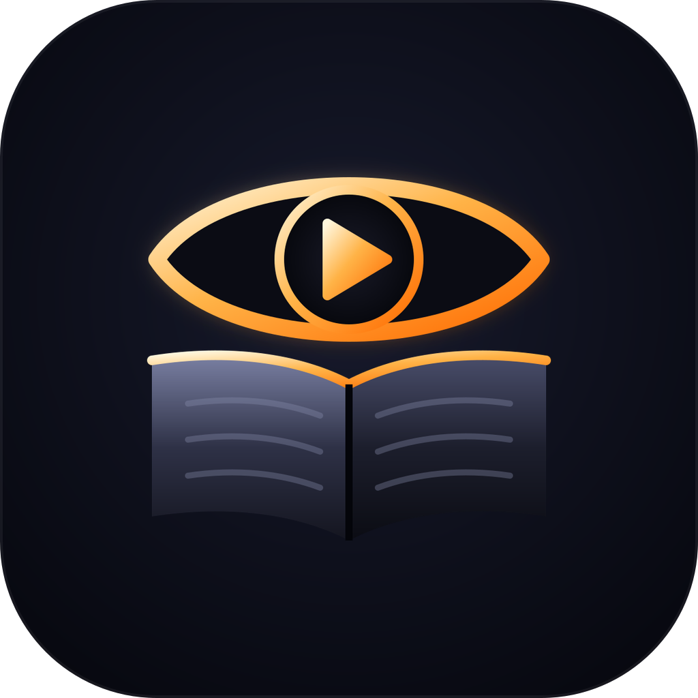
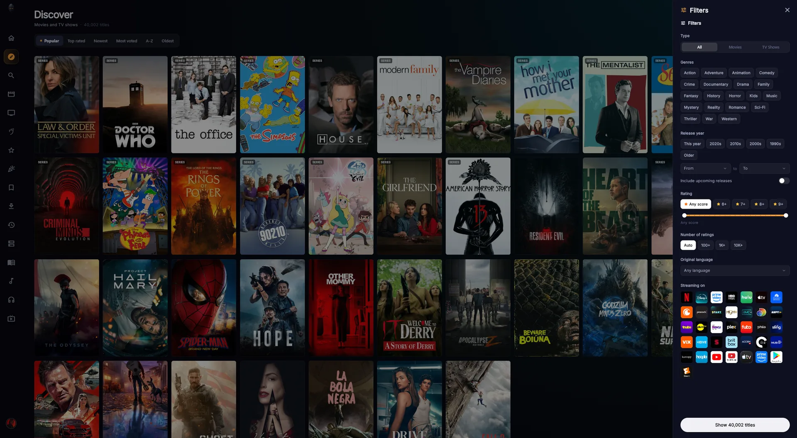
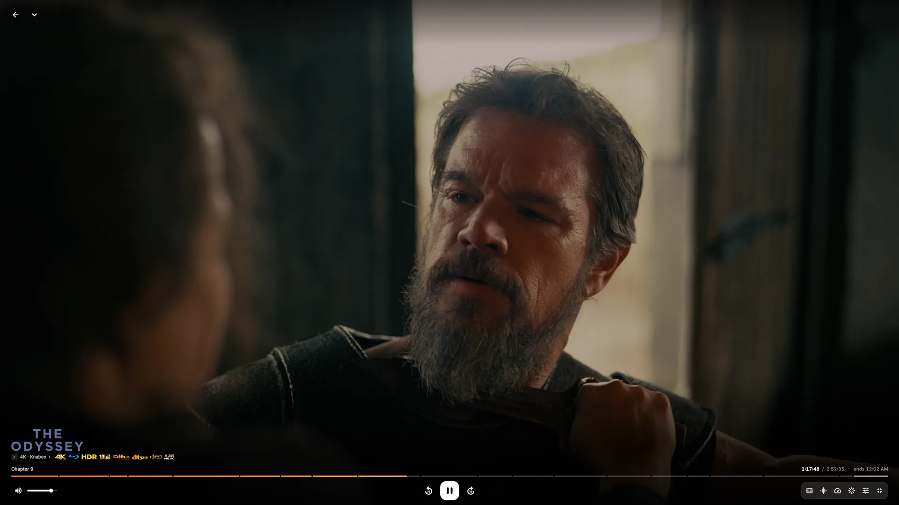
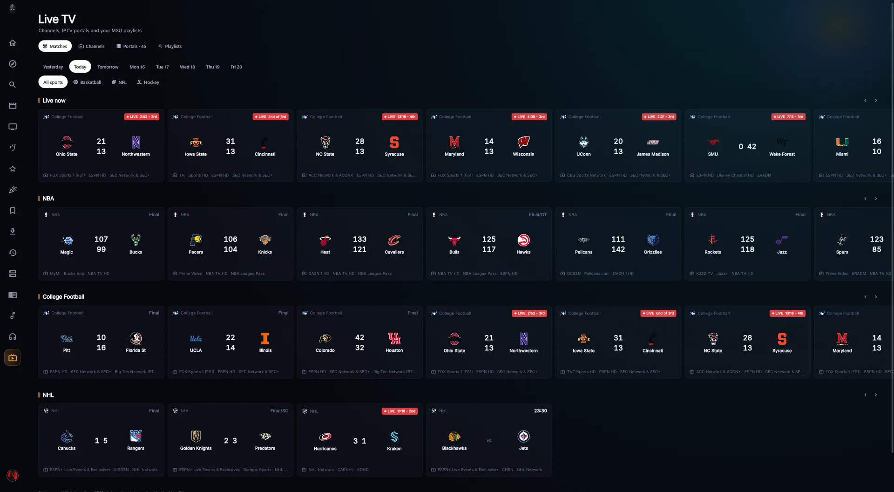
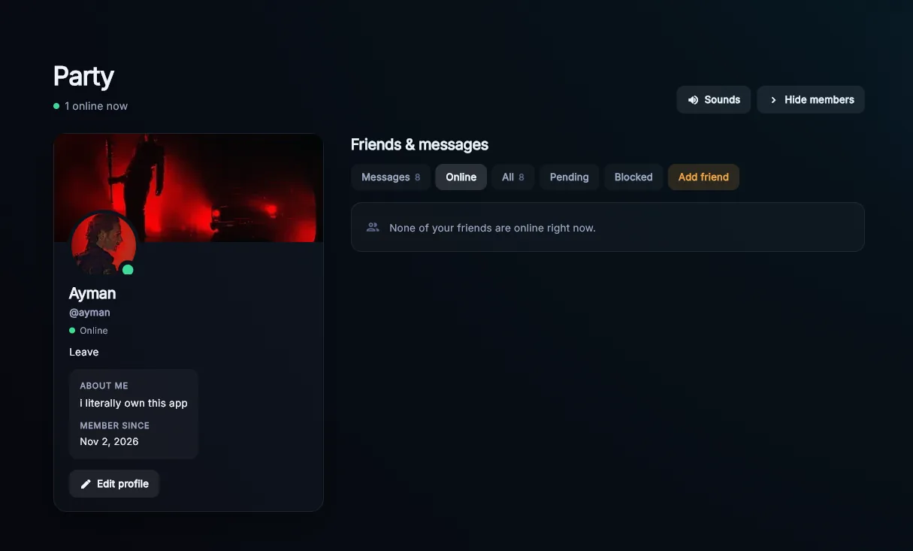

<p align="center"></p>

<h1 align="center">Lorewatch</h1>

<p align="center">
  Movies, shows, anime, live TV, music, manga and audiobooks in one app.
</p>

> **Lorewatch is a personal fork of [VyseTV](https://gitlab.com/ayman707-ux/vysetv) by Ayman Marwan**, released under the GNU GPL v3 or later like the original. Name, icon and app id have been changed so that it is not confused with the official builds, as the original author asks. Everything below this note is the original VyseTV documentation and still describes how the code works.

---

This is the source code of VyseTV, a free app for Windows, Android, macOS, Linux and iOS. If you only want to use it, you don't need anything from this page: get the app from [vysetv.cc](https://vysetv.cc/) or the [downloads page](https://gitlab.com/ayman707-ux/vysetvdownloads/-/releases/permalink/latest). The rest of this file is for people who want to know what is inside, build it themselves, or change it.

## Contents

- [Download](#download)
- [What it does](#what-it-does)
  - [Home, search and discovery](#home-search-and-discovery)
  - [The player](#the-player)
  - [Where things play from](#where-things-play-from)
  - [Anime](#anime)
  - [Live TV](#live-tv)
  - [Music](#music)
  - [Manga and audiobooks](#manga-and-audiobooks)
  - [Downloads](#downloads)
  - [Your own servers](#your-own-servers)
  - [Party](#party)
  - [Tracking](#tracking)
  - [Updates](#updates)
- [Platforms](#platforms)
- [What stays on your device](#what-stays-on-your-device)
- [Building from source](#building-from-source)
- [The server side](#the-server-side)
- [If you fork it](#if-you-fork-it)
- [How the code is laid out](#how-the-code-is-laid-out)
- [Making a release](#making-a-release)
- [Finding problems](#finding-problems)
- [Help, bugs and ideas](#help-bugs-and-ideas)
- [Credits](#credits)
- [Disclaimer](#disclaimer)
- [Licence](#licence)

## Download

The builds live in their own project so that this one can stay source only. These links always point at the newest version.

| Platform | File | Notes |
| --- | --- | --- |
| **Windows** 10 and 11 | [Installer](https://gitlab.com/ayman707-ux/vysetvdownloads/-/releases/permalink/latest/downloads/VyseTV-Setup.exe) | Recommended. Installs for your user, no administrator prompt. |
| | [Portable zip](https://gitlab.com/ayman707-ux/vysetvdownloads/-/releases/permalink/latest/downloads/VyseTV-Windows.zip) | Unzip anywhere and run `vyse_tv.exe`. |
| **Android** phones and tablets | [APK](https://gitlab.com/ayman707-ux/vysetvdownloads/-/releases/permalink/latest/downloads/VyseTV-Android-arm64.apk) | The one for almost every device. |
| | [APK, older 32-bit devices](https://gitlab.com/ayman707-ux/vysetvdownloads/-/releases/permalink/latest/downloads/VyseTV-Android-armv7.apk) | Only if the first one won't install. |
| | [APK, x86-64](https://gitlab.com/ayman707-ux/vysetvdownloads/-/releases/permalink/latest/downloads/VyseTV-Android-x86_64.apk) | Emulators and a few tablets. |
| **macOS** 14 or later | [Disk image](https://gitlab.com/ayman707-ux/vysetvdownloads/-/releases/permalink/latest/downloads/VyseTV-macos.dmg) | One file for Intel and Apple silicon. |
| **Linux** | [AppImage, x86-64](https://gitlab.com/ayman707-ux/vysetvdownloads/-/releases/permalink/latest/downloads/VyseTV-x86_64.AppImage) | Most PCs. |
| | [AppImage, ARM64](https://gitlab.com/ayman707-ux/vysetvdownloads/-/releases/permalink/latest/downloads/VyseTV-aarch64.AppImage) | ARM boards and laptops. |
| **iOS** 15.5 or later | [IPA](https://gitlab.com/ayman707-ux/vysetvdownloads/-/releases/permalink/latest/downloads/VyseTV-unsigned.ipa) | Unsigned, for sideloading. |

Every version, with checksums, is on the [releases page](https://gitlab.com/ayman707-ux/vysetvdownloads/-/releases).

The first time you open it:

- **Windows.** A "Windows protected your PC" box may come up: choose **More info**, then **Run anyway**. It appears because the installer isn't signed with a paid certificate.
- **Android.** Your browser or file manager asks once for permission to install apps. Allow it and continue.
- **macOS.** Open the disk image and drag VyseTV to Applications. If macOS says it can't check the app, right-click VyseTV, choose **Open**, then **Open** again.
- **Linux.** Make the file executable, then run it: `chmod +x VyseTV-*.AppImage && ./VyseTV-*.AppImage`. If nothing happens, install FUSE (`libfuse2`) or start it with `--appimage-extract-and-run`.
- **iOS.** The file is unsigned, so it needs a sideloading tool such as AltStore, SideStore or Sideloadly.

## What it does

### Home, search and discovery

The catalogue comes from TMDB. Home opens with a spotlight, then what's popular and what you're in the middle of. Discover is a wall of posters with filters. Every film and show has a details page with its cast, seasons and episodes, and every person has a page with what they've been in.

- **Search** finds movies, shows and people. You can also paste a stream link or a magnet into it and it plays.
- **My List** keeps what you want to watch. **History** keeps what you did watch and where you stopped.
- **Continue watching** picks a film or episode up at the second you left it.
- Sign in and your list, your progress, your settings, your manga and your audiobooks follow you from one device to the next.

<p align="center"></p>

### The player

<p align="center"></p>

The player is mpv, through the player that [Plezy](https://github.com/edde746/plezy) built around it. It is the part of the app the most work went into, and it is meant for the files other players stutter on.

- **Real HDR.** 4K HDR is shown as HDR on an HDR screen and mapped to SDR on one that isn't.
- **Lossless surround, up to 7.1.** TrueHD, DTS-HD and Atmos are passed straight through to a receiver or soundbar.
- **Hardware decoding.** 4K and 10-bit HEVC are decoded by the graphics card, not the processor.
- **Upscaling.** Anime4K, ArtCNN and NVScaler shaders sharpen lower-resolution video while it plays.
- **Refresh-rate matching.** The screen switches to the film's frame rate so motion stays even.
- **Subtitles.** Full ASS rendering with libass, a style menu (the same one in Settings and in the player), a sync panel for subtitles that run early or late, and the old Windows code pages that many SRT files still use. Subtitle addons plug in next to the built-in lookup.
- **Skipping.** Skip buttons for intros, recaps, previews and credits, wherever TheIntroDB has the timings.
- **The rest.** Chapters on the seek bar, every audio language in the file, an episode list inside the player, picture-in-picture, and a mini player that keeps the video going while you browse.

The video is a native mpv surface that sits behind the Flutter interface, not a texture copied into it. That is why HDR and passthrough survive, and it is also why Windows needs a patched Flutter engine (see [Building from source](#building-from-source)).

### Where things play from

- **Built-in sources.** The app works the moment it is installed. In Settings you choose the order sources are asked in and switch off the ones you don't want.
- **Stremio addons.** Paste an addon's link and its streams show up next to everything else. Stream addons and subtitle addons are used; catalogue and metadata addons are left alone, because the catalogue is already there.
- **P2P streaming.** Torrents play while they download. The engine (TorrServer) is inside the app and runs next to it. It fetches pieces in the order the player reads them, and when a torrent holds many files it picks the right one by name or asks you. The app asks before the first torrent plays, because P2P shows your address to the other peers.
- **Debrid.** Real-Debrid, AllDebrid, Premiumize, Debrid-Link and TorBox, for instant links instead of P2P.
- **Links and magnets.** Anything you paste into search: a direct video link, an HLS playlist or a magnet.
- **A local relay.** Some streams only play with particular headers or from a particular place. A small relay on `127.0.0.1` sits between those and the player.
- **Networks that block things.** When the local DNS answers with a dead address for a host the app needs, it looks the host up over DNS-over-HTTPS and connects anyway.

### Anime

Anime has its own section, browsed from AniList with its filters (season, format, genre and so on), with its own details pages and its own sources. If you connect AniList, your list there is kept up to date as you watch.

### Live TV

<p align="center"></p>

- **Portals and playlists.** Add your IPTV portals and M3U playlists once. The app sorts the channels and shows what is on now and next.
- **Matches.** The day's fixtures and scores, with the channels showing them. Fixtures come from ESPN's public scoreboard. To find which exact feed has a game, the app reads each candidate channel's guide around kick-off.
- **Favourites** are kept per portal, so the same channel on two portals is two favourites.
- **A portal browser** for going through one portal's categories, with a player pane beside the list.
- **Sharing a channel.** In a room you can put a live channel on for everyone. Portals usually allow one connection, so the stream goes through a small relay on the server and the room watches that.

### Music

Music is browsed from YouTube Music: search, home, artists, albums, playlists, charts, moods and radio. Your liked songs and playlists are kept with your account, lyrics show while a song plays, and the player keeps going while you use the rest of the app. One thing plays at a time: starting a film pauses the music, and the other way round.

### Manga and audiobooks

- **Manga.** A library and a reader that remembers your page and your reading mode.
- **Audiobooks.** Search, listen, and pick up where you stopped.

### Downloads

From the player you can save what is playing and watch it later without a connection. Direct files resume after a pause, HLS streams are saved with their audio and subtitle tracks, and torrents are read in full. Downloads are not offered in a watch party or for titles from your own servers.

### Your own servers

Plex, Jellyfin and Emby get their own section, side by side, on top of Plezy's server engine. Sign in to a server and its libraries are browsable and playable in the same player. You choose who marks things watched: the server by itself, or VyseTV by asking.

### Party

<p align="center"></p>

Party is the social half of the app. It needs an account, which is free.

- **Profiles.** A name, an avatar, a bio, a banner and a status line. Other people never see your email. A private account shows almost nothing to people who aren't friends.
- **Friends.** Requests both ways, and blocking.
- **Direct messages.** With typing and read marks. Messages last a day and are then removed.
- **Rooms with voice.** Open a room and talk. A room is public, or private with a code. Voice has hold-to-talk, mute and deafen, and small sounds for people arriving and leaving. The owner can rename the room, set a topic, change the code, mute or remove people, and hand the room to someone else.
- **Watching together.** Press play for the whole room, and playback is kept in step for everyone. Copying the stream's link and opening it in another player are switched off while you're in a party.
- **Listening together.** The host's music player leads, and everyone else follows with their own copy of the song.
- **Live TV together.** See [Live TV](#live-tv).
- **Libraries on profiles.** A profile can show the person's My List and their music.
- **A mini chat** that floats over the rest of the app, like the mini player.

### Tracking

AniList, Simkl and Trakt can be connected in Settings.

- What you watch is scrobbled while you watch it.
- My List goes to the service as its watchlist or "plan to watch".
- An import shows what it would bring in before anything changes.
- Updates that can't be sent (no connection, or the service asked the app to slow down) wait in an outbox and go later. The outbox holds the state you want, not a log of calls, so a later episode replaces an earlier one.

### Updates

The app checks for a new version when it starts and offers it once per start.

- **Windows, installed copy:** downloads the next installer, checks it, runs it silently and starts again.
- **Windows, portable copy:** downloads the zip, checks it, swaps the files after the app closes and starts again.
- **Android:** downloads the right APK for the device, checks it and hands it to Android's installer.
- **Linux:** downloads the new AppImage, checks it and swaps it in.
- **macOS:** opens the new disk image.
- **iOS:** opens the download link.

The list of versions is signed. A copy of the app only believes a list that carries a valid signature from the release key, and it checks every download against the SHA-256 the list gives. More under [Making a release](#making-a-release).

## Platforms

| Platform | Minimum | What you get |
| --- | --- | --- |
| Windows | 10, x64 | Installer and portable zip |
| Android | 7.1 (API 25) | APKs for arm64, armv7 and x86-64 |
| macOS | 14 | One disk image for Intel and Apple silicon |
| Linux | A recent desktop distribution | AppImages for x86-64 and ARM64 |
| iOS | 15.5 | Unsigned IPA |

Windows and Android are the two I build on my own PC and use every day, so they are the most tested. The macOS, iOS and Linux builds compile, package and are published with every release, but they have had far less use so far. If one of them misbehaves for you, tell me on Discord or open an issue. That is how they get better.

Two things worth knowing about Linux: on Wayland the video is its own surface under the interface, and on X11 (or when a compositor refuses that surface) the app falls back to drawing the video into a texture.

## What stays on your device

- **Debrid keys** are kept in the system keychain and are not stored on the account server. One thing to know: in a watch party the whole room plays the host's debrid link. That puts the host's account at some risk with any service, so the app asks the host first, once per room. With TorBox the link also has the API key inside it, and the warning says so.
- **Tracker sign-ins** (AniList, Simkl, Trakt) stay on the device that signed in.
- **Server sign-ins** (Plex, Jellyfin, Emby) stay in the keychain.
- **What you play from your own servers** stays out of history, out of the trackers and out of Party.
- **Links, files and magnets you paste** are treated the same way: they don't reach history, the trackers or Party.

What the account server does hold, if you make an account: your email (for signing in and resetting a password), your profile, your friends, your messages for a day, your list and your progress.

## Building from source

### What you need

- **Flutter 3.47.1, exactly.** Not newer, not older. Windows needs a patched engine that only matches this version, and the rest of the build is pinned to the same one.
- **Git** and **Python 3** (for the helper scripts).
- Then, per platform:
  - **Windows:** Visual Studio 2022 with the "Desktop development with C++" workload. Inno Setup 6.3 or newer if you want the installer.
  - **Android:** Android Studio or the command-line SDK, and Java 21.
  - **Linux:** clang, CMake, ninja and the libraries listed below.
  - **macOS and iOS:** a Mac with Xcode 26. The Swift code uses APIs from that SDK.

### Get the code

```bash
git clone https://gitlab.com/ayman707-ux/vysetv.git
```

```bash
cd vysetv
```

```bash
flutter pub get
```

Then give the build its server settings. The official builds' server is not in this repository, so this step is required, even if you leave the file as it comes:

```bash
cp lib/data/server_config.example.dart lib/data/server_config.dart
```

With the example's empty values the app has no accounts, no Party and no update check. Everything else works. See [The server side](#the-server-side).

The repository carries the torrent engine's binaries for every platform under `packages/torrserver_flutter/binaries`, so the clone is close to 300 MB.

### Keys

Nothing has to be set up for a first build.

- **TMDB.** A key is built in. To use your own: `--dart-define=TMDB_API_KEY=yourkey` on any `flutter build` or `flutter run` line.
- **Trackers.** The client ids are in `lib/data/trackers/tracker_keys.dart`, with a note above each on how to register your own. They are client ids only. None of the sign-ins needs a secret, and none belongs in that file.

### Windows

The player puts the mpv video underneath the Flutter interface in one window. Stock Flutter can't do that, so the build uses the patched engine from [flutter-plezy](https://github.com/edde746/flutter-plezy). A script downloads it, checks its hash and puts it in your Flutter SDK's cache:

```powershell
flutter precache --windows
```

```powershell
./windows/tool/install-patched-engine.ps1
```

```powershell
flutter build windows --release
```

The result is in `build/windows/x64/runner/Release`.

Things that will bite you:

- `flutter upgrade` and `flutter precache --force` quietly put the stock engine back. The app then builds and runs, but the video is invisible. Run the script again.
- With a stock `flutter_windows.dll` the CMake step fails outright.
- libmpv is downloaded during the build, pinned by `mpv-build.lock.json`.

### Android

```bash
flutter build apk --release --split-per-abi
```

Three APKs come out under `build/app/outputs/flutter-apk`: arm64-v8a, armeabi-v7a and x86_64.

Release builds are signed with the debug keystore of the machine that builds them. A build you make can't be installed over an official one, and the other way round, because Android refuses an update signed with a different key. Uninstall first, or change the application id.

### Linux

The libraries, as the CI machine installs them on Ubuntu 24.04:

```bash
sudo apt-get install -y --no-install-recommends clang cmake ninja-build pkg-config zstd libgtk-3-dev liblzma-dev libstdc++-12-dev libepoxy-dev libegl-dev libgl-dev libwayland-dev wayland-protocols libxkbcommon-dev libasound2-dev libass-dev libfreetype-dev libfontconfig-dev libfribidi-dev libharfbuzz-dev libgnutls28-dev libpipewire-0.3-dev libva-dev libvdpau-dev libx11-dev libxext-dev libxrandr-dev libxss-dev libxpresent-dev libpulse-dev libdbus-1-dev libdrm-dev libgbm-dev liblcms2-dev libxcursor-dev libxi-dev libevdev-dev libdisplay-info-dev libmujs-dev liblua5.2-dev libsecret-1-dev libjsoncpp-dev libgstreamer1.0-dev libgstreamer-plugins-base1.0-dev gstreamer1.0-plugins-base gstreamer1.0-plugins-good desktop-file-utils file
```

Then fetch the pinned libmpv and build:

```bash
python3 scripts/fetch_linux_libmpv.py --dest libmpv-prefix
```

```bash
flutter build linux --release
```

Turning the bundle into an AppImage takes a few more steps (bundling libmpv and its libraries, making the torrent engine executable, running `linux/packaging/build-appimage.sh`). The Linux job in `.github/workflows/build.yml` has them in order and is the reference.

### macOS and iOS

The Apple builds get mpv through MPVKit, a Swift package. `flutter build` skips package updates, so the packages have to be resolved first:

```bash
flutter build macos --config-only --release
```

```bash
flutter build macos --release
```

For iOS, without signing:

```bash
flutter build ios --config-only --release --no-codesign
```

```bash
flutter build ios --release --no-codesign
```

Before either build, the torrent engine has to be unpacked from `packages/torrserver_flutter/binaries`. The macOS and iOS jobs in the workflow file show how, and how the disk image and the unsigned IPA are packaged.

### The workflow file

`.github/workflows/build.yml` builds every platform and was written for GitHub Actions. Nothing runs it on GitLab. It stays in the repository because it is the most exact description there is of how each platform is built, checked and packaged.

## The server side

Three things run on a server, and the app talks to them:

- **Accounts and Party data:** [PocketBase](https://pocketbase.io/), with hooks for friends, messages, rooms and moderation.
- **Voice:** [LiveKit](https://livekit.io/). The app asks the account server for a short-lived token and then connects to LiveKit directly.
- **The live relay:** a small program that holds one live TV connection and shares it with a room.

None of that is in this repository: not the official server's address, not its code, not its configuration. A build made from this source starts without a server. To give it one, run your own (PocketBase for accounts and Party, LiveKit for voice) and put its address in `lib/data/server_config.dart`, the file you made from the example next to it. Git ignores that file, so your address stays on your machine too.

Everything that isn't Party works without an account and without that server: browsing, playing, sources, live TV, music, downloads, trackers and your own servers.

## If you fork it

You're welcome to. Three things to change first, so your build stands on its own:

1. **The account server.** You need your own. The official one is not in the source and is not there for other builds to use: it is one small machine, paid for out of my pocket. Set `accountServer` in `lib/data/server_config.dart`, or leave it empty and ship without accounts and Party.
2. **The update check.** Set `updateListAddresses` in the same file to where your own list is published, and replace the public key in `lib/data/update_signature.dart` with the public half of your own ECDSA P-256 key. `scripts/make_update.py` writes and signs the list. Left empty, the app never looks for an update.
3. **The name and the icon.** The code is GPL. The name VyseTV and the helmet are how people recognise the official builds, so give your fork its own.

## How the code is laid out

```
lib/
  main.dart            start-up
  core/                theme, layout rules, navigation, the trouble logs
  data/                everything the screens ask for
    account.dart         the account server client
    server_config.example.dart   where a build's own server addresses go
    tmdb.dart            the catalogue
    sources.dart         a playable stream, and the list of where to ask
    film_sources/        built-in film and TV sources
    anime_sources.dart   built-in anime sources
    addons.dart          Stremio addons
    torrents.dart        the P2P engine's driver
    debrid/              the five debrid providers
    downloads.dart       saving for offline
    stream_proxy.dart    the local relay
    net.dart             the HTTP client that gets through blocked DNS
    live_tv.dart, live_guide.dart, sports_schedule.dart, match_finder.dart
    music/, music_player.dart
    party/               friends, messages, rooms, voice, watching together
    trackers/            AniList, Simkl, Trakt, the outbox
    updater.dart, update_signature.dart
  media_servers/       Plex, Jellyfin and Emby in VyseTV's own pages
  mpv/                 the Dart side of the player
  plezy/               Plezy's server engine, used by media_servers/
  screens/             one file or folder per page
  services/, models/   the IPTV, manga, music and audiobook backends
  widgets/             shared pieces of interface
packages/
  torrserver_flutter/        the torrent engine and its binaries
  screen_brightness_windows/ an empty stand-in (see below)
shared/                C++ shared by the native players
windows/runner/mpv/    the Windows player
windows/installer/     the Inno Setup script
windows/tool/          the patched-engine installer
linux/runner/mpv/      the Linux player, with the texture fallback
linux/packaging/       AppImage scripts
android/.../plezy/     the Android player
ios/, macos/           the Apple players (Runner/MpvPlayer)
scripts/               release helpers
assets/                fonts, shaders, sounds, logos
branding/              the mark and the screenshots on this page
```

Notes for anyone reading the code:

- Code that came from Plezy is kept close to the original so it can be compared and updated. What VyseTV added on top is marked with "VyseTV" in the file: `vyse_extras.dart`, `vyse_video.dart`, the `extras/` folder, the Linux texture fallback.
- `packages/screen_brightness_windows` is deliberately empty. The real plugin changes monitor brightness over DDC/CI, and on at least one monitor that restarted the screen. The stand-in keeps the dependency happy and does nothing.
- User-facing text is plain on purpose: short, specific, no exclamation marks. Keep it that way if you add any.
- On phones, sheets and pop-ups open on the root navigator. Otherwise the bottom bar covers them.

## Making a release

This is how the official builds are made. You only need it for a fork.

1. Bump `version:` in `pubspec.yaml`, both parts. The part after `+` becomes Android's version code, and Android refuses a lower one.
2. Build each platform.
3. `python scripts/make_release.py` gathers what a Windows PC builds into `dist/<version>/`: the installer, the portable zip and the three APKs. It builds nothing and uploads nothing.
4. Upload the files somewhere with direct https links.
5. `python scripts/make_update.py <version> --notes "..." --file <platform> <built file> <link> ...` writes `latest.json` with each file's size and SHA-256 and signs it (ECDSA P-256). `--publish` puts the two files on the server.

The private half of the release key is not in this repository and never will be. It lives on one PC. The public half is the constant `updatePublicKey` in the app.

## Finding problems

- **Frame timing.** Build with `--dart-define=VYSE_PERF=true` and the app writes one summary line per second to `vyse_perf.log` in the temp folder.
- **Music that won't play.** `vyse_music/music-log.txt` in the temp folder: one block per song, with what was asked for and what came back.
- **Subtitles that vanish or drift.** `vyse_subs/subtitle-log.txt` in the temp folder, one section per player session.
- **Windows renderer.** The app runs on Skia on Windows. Impeller made the home spotlight stutter, and the opt-out is in `windows/runner/main.cpp`.

## Help, bugs and ideas

The [Discord server](https://discord.gg/dUJTGnUhz2) is the fastest way to reach me and the other people using the app. Bugs and requests can also go in this project's issues. For a bug, say which platform, which version (Settings, About) and what you were playing from: a built-in source, an addon, a torrent, a debrid link, live TV or your own server. Most problems turn out to depend on that.

Merge requests are welcome. Small and focused ones get looked at soonest.

## Credits

VyseTV stands on a lot of other people's work.

- **[Plezy](https://github.com/edde746/plezy)** (GPL-3.0), by edde746. The player and the media server engine come from it: the Dart player in `lib/mpv`, the native players for every platform, and `lib/plezy`. VyseTV is not affiliated with Plezy and doesn't use its name or logo.
- **[flutter-plezy](https://github.com/edde746/flutter-plezy)**, the patched Flutter engine for Windows, and **[mpv-build](https://github.com/edde746/mpv-build)**, the libmpv builds the players link against.
- **[mpv](https://mpv.io/)**, **FFmpeg** and **libass**, which do the actual playing.
- **[TorrServer](https://github.com/YouROK/TorrServer)** (GPL-3.0), by YouROK: the torrent engine.
- **PlayTorrio** (GPL-3.0): the anime sources, the built-in torrent search and the debrid providers were ported from it.
- **The Vyla SDK**: the film and TV sources were ported from its scrapers.
- **Anime4K**, **ArtCNN** and **NVIDIA Image Scaling**: the upscaling shaders in `assets/shaders`.
- **[TMDB](https://www.themoviedb.org/)**: the catalogue. This product uses the TMDB API but is not endorsed or certified by TMDB.
- **[AniList](https://anilist.co/)**: the anime catalogue and lists.
- **TheIntroDB**: intro and segment timings.
- **ESPN's public scoreboard**: fixtures and scores.
- **[PocketBase](https://pocketbase.io/)** and **[LiveKit](https://livekit.io/)**: the account server and voice.
- **Flutter**, and every package in `pubspec.yaml`.

If something of yours is in here and isn't credited properly, tell me and I'll fix it.

## Disclaimer

VyseTV is a player and a browser. It doesn't host, store or distribute any video, music, books or streams. What it plays comes from sources on the internet, from your own servers, and from the addons, portals and playlists you add yourself. What you open with it, and whether that is allowed where you live, is up to you.

## Licence

VyseTV is free software, released under the GNU General Public License, version 3. The full text is in [LICENSE](LICENSE).

Copyright (C) 2026 the VyseTV authors.

This program is distributed in the hope that it will be useful, but without any warranty; without even the implied warranty of merchantability or fitness for a particular purpose. See the licence for details.

The parts that come from other projects keep their own copyright notices and licences. Plezy, TorrServer and PlayTorrio are GPL-3.0 as well, and `packages/torrserver_flutter` carries its own licence files and notice.
